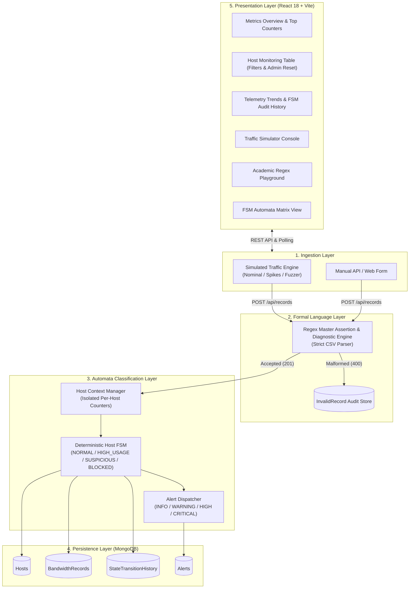
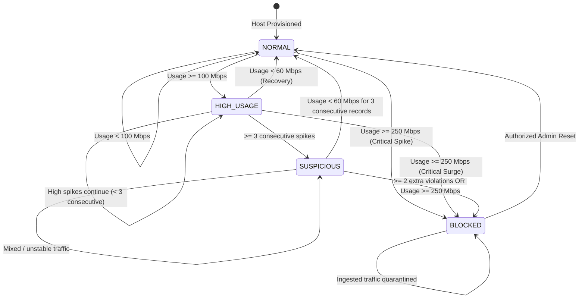

# Network Bandwidth Usage Monitoring and Threshold Alert System

A full-stack network telemetry processing prototype demonstrating the application of **Formal Language Theory (Regular Expressions)** for structural record validation and **Automata Theory (Finite-State Machines)** for deterministic host classification and anomaly detection.

---

## 1. System Architecture

The application ingests raw CSV network telemetry streams, executes structural validation with Regular Expressions, evaluates state transitions through a per-host Finite-State Machine, generates structured anomaly alerts, persists audit records in MongoDB, and serves an interactive dashboard.



---

## 2. Core Computer Science Academic Concepts

### A. Regular Expression Record Validation
Incoming bandwidth records must conform to the canonical comma-separated structure:
$$\langle\text{Timestamp}\rangle,\langle\text{HostID}\rangle,\langle\text{BandwidthMbps}\rangle,\langle\text{Direction}\rangle$$
*Example:* `2026-11-09T10:30:00,HOST001,125.50,UPLOAD`

#### The Master Regex Pattern:
```regex
^(?<timestamp>\d{4}-(?:0[1-9]|1[0-2])-(?:0[1-9]|[12]\d|3[01])T(?:[01]\d|2[0-3]):[0-5]\d:[0-5]\d),(?<hostId>[A-Z0-9_-]{3,16}),(?<bandwidth>\d+(?:\.\d{1,2})?),(?<direction>UPLOAD|DOWNLOAD)$
```

#### Component-by-Component Explanation:
| Subpattern | Matching Target | Purpose & Validation Rules |
|---|---|---|
| `^` | Start of string | Asserts start of input; blocks prepended garbage characters. |
| `\d{4}-` | Year | Restricts to 4-digit Gregorian calendar year. |
| `(?:0[1-9]\|1[0-2])-` | Month | Bounds month strictly between `01` and `12` (rejects `13`, `00`). |
| `(?:0[1-9]\|[12]\d\|3[01])` | Day | Bounds day strictly between `01` and `31`. |
| `T` | Delimiter | Literal ISO 8601 delimiter separating date and time. |
| `(?:[01]\d\|2[0-3]):` | Hours | 24-hour military hour bounds (`00` to `23`). |
| `[0-5]\d:` | Minutes | Minute bounds (`00` to `59`). |
| `[0-5]\d` | Seconds | Second bounds (`00` to `59`). |
| `,` | Delimiter 1 | Literal CSV comma boundary between Field 1 and Field 2. |
| `[A-Z0-9_-]{3,16}` | Host ID | Restricts identifier to 3–16 uppercase alphanumerics, hyphens, or underscores. |
| `,` | Delimiter 2 | Literal CSV comma boundary between Field 2 and Field 3. |
| `\d+(?:\.\d{1,2})?` | Bandwidth | Non-negative integer or float with up to 2 decimal places. Rejects negative signs, letters, or excessive precision. |
| `,` | Delimiter 3 | Literal CSV comma boundary between Field 3 and Field 4. |
| `(UPLOAD\|DOWNLOAD)` | Direction | Strict case-sensitive enumeration. |
| `$` | End of string | Asserts end of input; rejects extra fields or trailing injections. |

---

### B. Finite-State Machine (FSM) Host Classification

Each monitored host is modeled as an independent Deterministic Finite Automaton:
$$M = (Q, \Sigma, \delta, q_0, F)$$

- **Set of States $Q$:**
  $$Q = \{\text{NORMAL}, \text{HIGH\_USAGE}, \text{SUSPICIOUS}, \text{BLOCKED}\}$$
- **Initial State $q_0$:**
  $$q_0 = \text{NORMAL}$$
- **Quarantine Terminal State $F$:**
  $$F = \{\text{BLOCKED}\}$$ *(Requires authorized manual intervention to exit)*



#### Deterministic Transition Table ($\delta$):
| Current State ($s$) | Input Event / Condition ($\sigma$) | Next State ($s'$) | Alert Severity | Operational Rule |
|---|---|---|---|---|
| **NORMAL** | $Usage \ge 100\text{ Mbps} \land Usage < 250\text{ Mbps}$ | **HIGH_USAGE** | `WARNING` | High threshold crossed; `streak = 1`. |
| **NORMAL** | $Usage \ge 250\text{ Mbps}$ (Critical) | **BLOCKED** | `CRITICAL` | Severe surge detected; instant quarantine. |
| **NORMAL** | $Usage < 100\text{ Mbps}$ | **NORMAL** | None | Nominal traffic; counters cleared. |
| **HIGH_USAGE** | $Usage < 60\text{ Mbps}$ | **NORMAL** | `INFO` | Bandwidth returned below recovery threshold. |
| **HIGH_USAGE** | $Usage \ge 100\text{ Mbps}$ ($< 3$ consecutive) | **HIGH_USAGE** | None | Spikes accumulate (`streak` incremented). |
| **HIGH_USAGE** | $Usage \ge 100\text{ Mbps}$ ($\ge 3$ consecutive) | **SUSPICIOUS** | `HIGH` | Repeated abnormal spikes quota reached; classified as SUSPICIOUS. |
| **HIGH_USAGE** | $Usage \ge 250\text{ Mbps}$ | **BLOCKED** | `CRITICAL` | Critical surge in HIGH_USAGE; host quarantined. |
| **SUSPICIOUS** | $Usage \ge 100\text{ Mbps}$ ($\ge 2$ violations) | **BLOCKED** | `CRITICAL` | Tolerance limit exhausted in SUSPICIOUS; host BLOCKED. |
| **SUSPICIOUS** | $Usage \ge 250\text{ Mbps}$ | **BLOCKED** | `CRITICAL` | Critical surge in SUSPICIOUS; immediate quarantine. |
| **SUSPICIOUS** | $Usage < 60\text{ Mbps}$ ($3$ consecutive records) | **NORMAL** | `INFO` | Safe traffic maintained for recovery period; restored to NORMAL. |
| **BLOCKED** | Any incoming traffic | **BLOCKED** | None | Traffic quarantined; state locked. |
| **BLOCKED** | Authorized Admin Reset Action | **NORMAL** | `INFO` | Host unlocked; state restored, all counters cleared. |

---

## 3. Technology Stack

- **Frontend:** React 18, Vite, Tailwind CSS, Lucide React, Recharts.
- **Backend:** Node.js (v24), Express.js, CORS, Morgan, Dotenv.
- **Database:** MongoDB 9.0 + Mongoose (with self-healing fallback to embedded in-memory MongoDB via `mongodb-memory-server` using local `mongod.exe`).
- **Testing:** Node.js Native Test Runner (`node:test`, `node:assert`).

---

## 4. Setup and Installation

### Prerequisites
- Node.js (v18+ or v24+ recommended)
- npm (v9+)

### Single-Command Out-of-the-Box Launch
```powershell
# 1. Install dependencies
cd backend && npm install
cd ../frontend && npm install

# 2. Build frontend production assets
npm run build

# 3. Start unified application (serves both API and UI on Port 5000)
npm start
```
Open your browser at: **`http://localhost:5000`**

### Alternative: Concurrent Development Mode
```powershell
# Terminal 1: Backend API (Port 5000)
cd backend
npm run dev

# Terminal 2: Frontend Vite Dev Server (Port 5173 with HMR)
cd frontend
npm run dev
```
Open your browser at: **`http://localhost:5173`**

---

## 5. API Reference

### Records
- `POST /api/records`: Ingests a raw record string `{ rawRecord }` or batch array `{ records }`.
- `POST /api/records/validate-only`: Evaluates Regex validation without storing to DB.
- `GET /api/records`: Retrieves recent bandwidth records with optional `hostId` filter.
- `GET /api/records/invalid`: Retrieves forensic log of rejected malformed records.

### Hosts & FSM
- `GET /api/hosts`: Retrieves monitored hosts with state and search filters.
- `GET /api/hosts/:hostId`: Retrieves host profile and recent transition history.
- `POST /api/hosts/:hostId/reset`: Authorized administrative action to unlock a `BLOCKED` host.
- `GET /api/hosts/fsm/table`: Returns the active FSM state transition matrix.

### Alerts & Metrics
- `GET /api/dashboard/stats`: Returns high-level aggregate counters and alerts.
- `GET /api/alerts`: Retrieves anomaly alerts with severity filters.
- `PATCH /api/alerts/:alertId/ack`: Acknowledges an alert.

### Simulation
- `GET /api/simulation/status`: Current simulation state and metrics.
- `POST /api/simulation/start`: Starts automated traffic generation.
- `POST /api/simulation/stop`: Halts generation.
- `POST /api/simulation/tick`: Executes a single simulated step.
- `POST /api/simulation/config`: Updates interval or mode dynamically.
- `POST /api/simulation/inject`: Injects scenario presets (`ddos_burst`, `recovery_drill`, `malformed_test`).
- `GET /api/simulation/hosts` / `POST /api/simulation/hosts`: Fleet management.

---

## 6. Automated Test Suite

Run all automated test suites (Phases 2, 3, 4, 5, and 7):
```powershell
cd backend
npm test
```
**Test Coverage Summary:**
- **Phase 2 Foundation:** 8/8 tests passed
- **Phase 3 Regex Record Validation:** 23/23 tests passed
- **Phase 4 FSM & Anomaly Engine:** 11/11 tests passed
- **Phase 5 Traffic Simulation:** 14/14 tests passed
- **Phase 7 End-to-End Integration:** 10/10 tests passed
- **Total:** **66 / 66 tests passing (100% pass rate)**

---

## 7. Demonstration Guide
See [`demo/DEMO_WALKTHROUGH.md`](file:///c:/Users/Lenovo/OneDrive/Documents/New%20folder/demo/DEMO_WALKTHROUGH.md) for a step-by-step hackathon and academic presentation script. Sample records can be found in [`demo/sample_records.csv`](file:///c:/Users/Lenovo/OneDrive/Documents/New%20folder/demo/sample_records.csv).

---

## 8. System Limitations & Future Production Enhancements
1. **Network Hardware Integration:** This prototype uses a software simulation engine. Production deployment would integrate with hardware routers or switches via NetFlow/IPFIX/sFlow collectors or Linux eBPF kernel probes.
2. **Distributed FSM State Store:** In multi-node cluster deployments, per-host FSM contexts would be cached in Redis with distributed locks (Redlock) to ensure linearizability across horizontal worker instances.
3. **Automated Enforcement:** While this prototype flags and quarantines hosts in software, an enterprise deployment would emit automated firewall rules (e.g., Linux `iptables`/`nftables` or cloud security group modifications) to block offending IPs at the transport layer.
